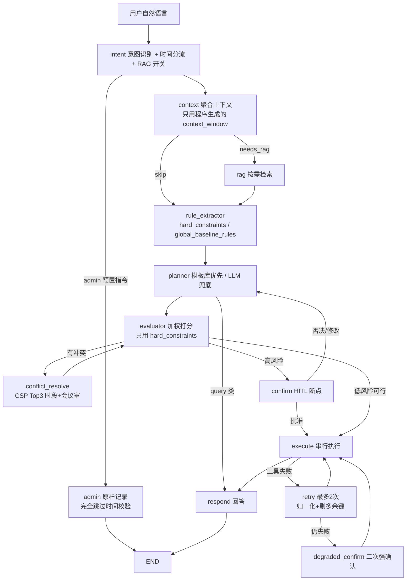

# 日程任务自动编排 Agent

面向办公场景的「自然语言 → 推演方案 → 确认 → 工具执行」Agent。基于 LangGraph 构建规划型工作流：识别意图后一次性聚合上下文，按需要检索制度文档并抽取结构化规则，Planner 生成多个候选方案，Evaluator 用约束求解器加权打分，高风险操作通过 Human-in-the-loop 断点等用户确认后才写入数据库。大模型接入智谱 GLM（`glm-4-plus`，OpenAI 兼容模式）。

## 一、已实现能力

| 需求 | 实现位置 | 说明 |
| --- | --- | --- |
| 三层结构化状态 | `app/graph/state.py` | `user_intent` / `context_bundle` / `candidate_plans` + `selected_plan` + `plan_decision` + `tool_traces` + `feedback` |
| **规则双集合** | `app/planning/rules.py`、`app/graph/nodes.py` | `hard_constraints`（会议室互斥、纪要时效、请假提前天数、报销截止、命名规范、审批链路）参与打分；`global_baseline_rules`（每周一 10:00 周会、周五更新看板）只做提示，**不计违规、不计分** |
| **加权 Evaluator** | `app/planning/constraint_solver.py` | 会议室冲突×10 + 参会人冲突×8；纪要超时×6 + 审批不合规×7 + 命名错误×3；临近里程碑延后×12。`total = 100 - 扣减`，low/medium/high 由分数区间自动映射 |
| **Planner 模板库** | `app/planning/templates.py` | 命中场景直接给确定性方案：无法参加周会 → 找人代参会+同步纪要 / 请假+交接 / 会议改期，按代价升序；时间类调用 CSP 输出 Top3 **具体时段 + 可用会议室** |
| **RAG 按需触发** | `app/graph/workflow.py` 的 `_rag_route` | 普通“查日程/查待办”跳过文档检索；主动问制度、创建/变更/规划类才检索并抽硬约束 |
| **工具重试与降级** | `app/graph/nodes.py` 的 `retry_node`、`degraded_confirm_node` | 工具 error 进入重试子节点，最多 2 次，自动归一化 ISO 时间、剔除多余 key；仍失败则 HITL 二次强确认，防止盲写 DB |
| **原子改期** | `app/models/repository.py`、`app/tools/calendar_tools.py` | `delete_schedule`（软删除可回溯）+ 独立 `reschedule_schedule` 工具；改期在**同一事务**内新建日程 + 取消原日程，确认后自动执行 |
| **模糊时段偏好（CSP 检索）** | `app/utils/time_periods.py`、`app/utils/nl_time.py`、`app/planning/templates.py` | “改到 11月27日下午、会议室优先 12F-A301” 不再抛 ValidationError：`parse_nl_time` 产出 `prefer` 结构（date/period/room_prefer），把日期+时段区间（morning 08–12 / afternoon 13–18 / evening 18–21）+偏好会议室交给 CSP，返回当天该时段 Top3 空闲时段进入 HITL 选择 |
| **删除动作确定性识别（Bug6）** | `app/graph/nodes.py` 的 `parse_delete_command`、`app/planning/plan_models.py` 的 `ActionType` | Intent 节点最前面用**独立正则**抓显式 `ID:数字`（不依赖 `TARGET_KEYS`，避免把日期数字误当 ID）；命中“删除/移除/取消 + ID”即判 `ActionType.DELETE`，走独立 `delete_confirm` HITL，确认后仅软删除（`delete_todo` / `delete_schedule`），**绝不进入 create_todo 生成“删除 xxx”待办**；查询待办默认过滤 `is_deleted=True` |
| **延后双维度提示** | `app/graph/nodes.py` 的 `_delay_guidance` | 输出【可权衡延后】模板：业务优先级、制度宽限窗口、风险提示分开展示，不直接判定“可以延后”；数据源为全局未完成待办，与查询窗口无关；按 `todo.id` 去重，同一待办只渲染一次卡片 |
| **待办段落按需展示** | `app/graph/nodes.py` 的 `_deadline_display`、`_deadline_section` | 「临近截止任务 / 可权衡延后」只在用户主动问到临近、截止、延后、待办等话题时附加到回答末尾；普通建日程、查日程、制度问答不再出现。「后续到期（供参考，非临近截止）」默认不展示，仅当用户明确要看全部/后续待办清单（如“列一下全部待办”）时才带出 |
| **待办时间语义隔离** | `app/services/context_service.py`、`app/graph/nodes.py` | 待办拆成三集合：`todos`（**仅 deadline 落在窗口内**，回答“某天的待办”）、`pending_todos`（全局未完成，供延后提示）、`near_deadline_todos`（**全局独立判断**临近截止，阈值 `NEAR_DEADLINE_HOURS=24` 可配）。关联日程时间**仅展示**，绝不参与筛选/排序/告警；纪要待办 deadline 固定为会议结束 + 24h |
| **时间语义分离** | `app/utils/nl_time.py`、`app/graph/state.py` | `context_window` 只作聚合查询窗口（完整自然日 00:00–23:59:59），由程序按业务时间推导（±1 天，查会议室仅当天）；会议/待办/请假/查会议室的业务时间进入 `target_time` 分组，**用户时间原文绝不直接进工具 Schema**；LLM 漏提“明天”时由确定性扫描兜底 |
| **数据清洗/窗口收缩** | `app/services/context_service.py`、`app/models/repository.py` | 脏日程（空白/单字符/非法时间/已取消）在写入与聚合两层过滤；窗口最多 7 天 |
| **管理员预置分支** | `app/graph/nodes.py` 的 `admin_node` | “周一10:00固定周会、11.26 14:00 15F-B205 已被占用”这类告知被识别为 admin，原样记录，**完全跳过时间解析与工具校验链路** |
| **调试信息隔离** | `app/graph/workflow.py` 的 `run_agent` | 默认只返回 `answer`；工具 trace、文档权重、打分明细仅在 `include_debug=True` 时出现，Web 界面永不渲染 |
| 冲突消解子流程 | `app/graph/nodes.py` + `app/planning/constraint_solver.py` | 冲突时用 `python-constraint` 求 Top3 可行时间窗口与空闲会议室，自动生成备选方案 |
| HITL 断点 | `app/graph/nodes.py` 的 `confirm_node` | 高风险/变更/规划类暂停；批准→执行，否决/修改→带 `feedback` 回到 Planner |
| 上下文聚合服务 | `app/services/context_service.py` | 一次查询拉取时间窗内日程 + 待办，替代多轮工具轮询 |
| Pydantic V2 工具 Schema | `app/tools/schemas.py` | 注册表自动生成**内联** Function Calling 描述（无 `$ref`）；`extra=forbid` 禁止额外字段；查询工具接 `context_window: TimeRange`，创建工具各接自己的业务时间字段；校验失败返回 `validation_error` + `errors` |
| 检索器可切换 | `app/rag/base.py` | `local`（BM25+jieba）与 `vector`（智谱 embedding-3 + FAISS）配置切换，向量失败自动降级 |

## 二、一键启动（推荐）

**双击项目根目录下的 `start.bat`**：自动切换目录、调用已装好依赖的 Python 环境、启动本地 Web 服务并打开浏览器（通常为 `http://127.0.0.1:8765/`）。关闭命令行窗口即停止服务。

> **当前为空白实例**：日程表与待办表已清空，双击启动后不会有任何历史日程/待办，所有数据都由你通过对话创建。`data/documents/` 下的制度文档属于知识库，不是日程数据，保留供 RAG 检索。若想重新恢复演示数据，可手动执行 `$PY main.py --init`（仅在你的明确要求下才会写入）。

Web 界面提供：多轮对话（Enter 发送 / Shift+Enter 换行）、方案卡片（具体推荐时段 + 会议室 + 风险）、批准/否决/修改按钮、工具失败时的二次强确认卡片。界面只呈现结论与方案，**不展示内部调试信息**。

服务由 `server.py` 用 Python 标准库 `http.server` 实现，无需 FastAPI/uvicorn；端口从 8765 起自动寻找可用值。HITL 通过 `thread_id` + `decision` 恢复，由 LangGraph `MemorySaver` 保存检查点。

## 三、命令行运行

依赖已预装；如需重装：`pip install -r requirements.txt`（含 `python-constraint`）。

> 本机 `python` 指向未安装依赖的裸解释器，实际运行请使用 WorkBuddy 默认虚拟环境：
> `PY=/c/Users/456/.workbuddy/binaries/python/envs/default/Scripts/python`

```bash
$PY main.py "明天下午3点安排项目复盘会"        # 单次提问（遇方案确认会提示输入）
$PY main.py --demo                          # 内置示例，自动批准方案
$PY main.py --debug "..."                   # 开发者模式：显示工具 trace、文档命中、反馈
$PY main.py                                 # 交互模式
$PY -m pytest tests -q                      # 离线测试（35 项，不消耗 API）
```

## 四、示例问题

- **查询（不触发 RAG）**：`查一下我明天有哪些日程，还有哪些待办`
- **待办窗口 + 临近截止（触发 RAG 取制度时限）**：`看看我明天有哪些待办，有没有临近截止的` —— 明天列表只含 deadline 在明天的待办；临近截止从**全局**独立判断，远期待办标注真实剩余天数，不会被误标为“明天临近截止”
- **制度查询（触发 RAG + 延后双维度提示）**：`提交差旅报销能不能延后？制度上限是什么？`
- **时间编排（Top3 具体时段 + 会议室）**：`帮我创建一个2026-11-26 14:00的技术评审，地点 15F-B205，时长2小时`
- **轻量折中方案 + HITL**：`我无法参加2026-11-22 10点的周会，帮我推演几种方案`（推荐代参会，其次请假交接、会议改期）
- **原子改期**：在方案确认时选择「会议整体改期」，新建与取消原日程在同一事务完成
- **请假推演**：`下周一到周三请假，帮我推演几种方案`（年假/事假/调休）
- **中文时间表达**：`下周四下午14:00–15:30 安排技术评审`（解析为 schedule_start/schedule_end，窗口自动取前后各一天）
- **待办截止**：`记个待办：截止到11月26日提交差旅报销`（进 todo_deadline，不污染查询窗口）
- **会议室单点查询**：`11月26日14:00 15F-B205 有人吗`（进 check_time，窗口仅当天）
- **预置信息告知**：`周一10:00固定周会、11.26 14:00 15F-B205已被占用`（admin 分支，不解析时间、不写库）

### 时间语义分离（核心修复）

| 字段 | 语义 | 来源 | 去向 |
| --- | --- | --- | --- |
| `context_window` | 聚合查询窗口 `{start, end}` | `parse_nl_time` 从业务时间**自动推导**，绝不接收用户时间原文 | `context_service` / `query_schedules` / `query_todos` |
| `target_time.schedule_start/end` | 会议起止 | 用户原文 → 解析层 | `create_schedule` |
| `target_time.todo_deadline` | 待办截止 | 用户原文 → 解析层 | `create_todo.deadline` |
| `target_time.leave_date/leave_end` | 请假日期 | 用户原文 → 解析层 | `apply_leave` |
| `target_time.check_time` | 查会议室单点 | 用户原文 → 解析层 | `check_room_occupancy` |

`parse_nl_time(text, intent_type)` 支持 `下周四下午14:00–15:30`、`截止到11月26日`、`12月2号`、`11.26 14:00`、`下周一到周三` 等表达，输出结构化 datetime 后再转 ISO 写入 State。查询类只填 `context_window`，`target_time` 恒空；admin 预置指令两者都空。开发者可用 `main.py --debug "..."` 查看分流结果。

## 五、架构



**状态流转要点**

1. `intent` 按语义子类型分流：`parse_nl_time(text, intent_type)` 把用户时间原文解析成 datetime。查询类只填 `context_window`；创建/变更类把业务时间填进 `target_time`，并由程序自动推导 `context_window`。admin 分支两者全空。
2. `context` 一次聚合查询填充 `context_bundle`，过滤脏日程；`rag` 只在需要时运行。
3. `rule_extractor` 把制度拆成两套集合：硬约束进入 Planner/Evaluator，基线只作为附加提醒。
4. `planner` 模板命中时直接给出低扰动方案与具体时段；否则由 LLM 生成，解析失败有确定性兜底。
5. `evaluator` 按“可行性 → 代价 → 分数”排序，代价标签由分数映射，用户侧不见权重明细。
6. `execute` 串行调用工具，改期走原子事务；失败进入 `retry`，两次失败后 `degraded_confirm` 强确认。
7. `respond` 只接收用户可见事实；原始 trace、文档权重、打分明细留在 State，默认不返回。

## 六、工具与结构化错误

当前注册 10 个工具，每个只校验自己关心的时间字段：

| 工具 | 时间字段 | 说明 |
| --- | --- | --- |
| `create_schedule` | `start_time` / `end_time` | 会议室用 `room_prefer`；模糊时段走 prefer 分支，不直接校验 |
| `query_schedules` | `context_window: {start, end}` | 程序生成的查询区间 |
| `create_todo` | `deadline` | 内容字段为 `content`，可带 `link_schedule_id` |
| `query_todos` | `context_window: {start, end}` | 按截止时间过滤，默认排除已软删除待办 |
| `apply_leave` | `leave_date` | 请假类型 `leave_type` |
| `check_room_occupancy` | `check_datetime` | 单点时间 + `room_name` |
| `delete_schedule` | — | 日程软删除，可回溯 |
| `delete_todo` | — | 待办软删除（仅置 `is_deleted=True`，不新增任何记录），可后台找回 |
| `reschedule_schedule` | `start_time` / `end_time` | 独立改期：软删除原日程 + 新建日程原子事务；`target_date`/`period_prefer`/`room_prefer` 只记录偏好，不做时间校验 |
| `search_documents` | — | RAG 检索 |

不存在任何承接所有时间文本的 `focus_time` 字段。旧字段名（`title`/`due_time`/`location`）在 Pydantic 层通过别名兼容，重试自愈时也会映射回新字段。

```json
// 成功
{"ok": true, "message": "已创建日程 #3：...", "schedule": {...}}

// 参数校验失败（validation_error，禁止额外字段）
{
  "ok": false,
  "error_code": "VALIDATION_ERROR",
  "error_type": "validation_error",
  "message": "工具 create_schedule 的参数校验失败（validation_error）",
  "errors": [{"loc": "start_time", "msg": "Value error, 请使用 ISO 8601 格式...", "type": "value_error"}]
}

// 重复调用
{"ok": false, "error_code": "DUPLICATE_CALL", "message": "重复调用 create_schedule，已拦截"}
```

校验失败后由 `retry_node` 自动剔除多余 key、归一化时间再试；两次失败则请求用户强确认。

## 七、切换向量检索

在 `.env` 中设置 `RAG_RETRIEVER=vector` 即使用智谱 `embedding-3` + FAISS，索引持久化到 `data/vector_index/`；embedding 服务不可用时自动回退本地 BM25。结构化日程/待办始终留在 SQLite，不写入向量库。

## 八、目录结构

```
schedule_agent/
├── start.bat                  # 双击一键启动 Web 界面
├── server.py                  # 标准库 HTTP 服务 + /api/chat（HITL 恢复）
├── web/                       # 前端：方案卡片、二次确认（不渲染调试信息）
├── main.py                    # CLI 入口（--debug 可查看内部轨迹）
├── config.py                  # pydantic-settings 配置
├── app/
│   ├── graph/                 # 三层状态、13 个节点（含 admin）、条件边装配
│   ├── planning/              # 模板库、规则拆分、加权打分、约束求解、LLM JSON 解析
│   ├── services/              # 上下文聚合查询服务
│   ├── tools/                 # Pydantic Schema、注册表、10 类工具、参数清洗
│   ├── models/                # SQLAlchemy 实体、仓储（软删除/原子改期）、数据库初始化
│   ├── rag/                   # 检索器抽象、本地/向量实现
│   ├── llm/                   # 智谱 Function Calling 客户端
│   └── utils/                 # 时间/枚举校验 + nl_time 自然语言时间解析层
├── data/documents/            # 业务文档样例（RAG 语料）
├── scripts/seed.py            # 演示数据
└── tests/                     # 离线测试（35 项）
```
